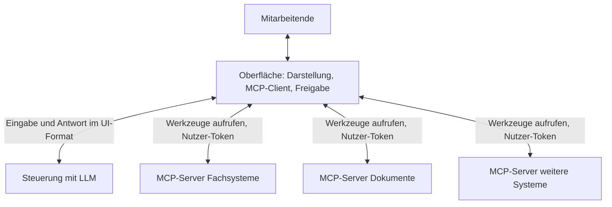
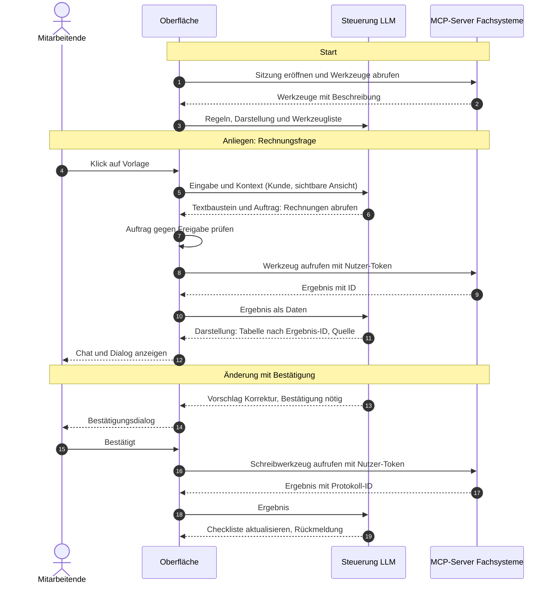

# BuUI: Basic Universal User Interface

Konzept und Mockup für eine universelle Oberfläche, die von einem Sprachmodell (LLM) gesteuert wird und Daten über MCP-Server abfragt. Das Beispiel ist der Kundenservice-Assistent.

**Lizenz:** Das Konzept (dieses README) steht unter [CC BY 4.0](LICENSE-CC-BY-4.0), © Abrad7. Das Mockup (`kundenservice-assistent.html`) steht unter der [MIT-Lizenz](LICENSE-MIT), © Abrad7. Bei Weiterverwendung bitte Urheber und Quelle nennen.

---

# Kundenservice-Assistent: Konzept und Aufbau

Status: Konzept und klickbares Mockup. Das Mockup zeigt Layout und Bedienung mit festen Beispieltexten. Die Anbindung an das LLM und an die MCP-Server ist hier beschrieben, aber im Mockup nicht umgesetzt.
Mockup-Datei: `kundenservice-assistent.html`
Zielgruppe: Entwicklerinnen und Entwickler sowie Designerinnen und Designer, die dieses Konzept in ein Produkt überführen

---

## 1. Idee in einem Absatz

Servicemitarbeitende bearbeiten viele verschiedene Anliegen (Neukunde anlegen, Rechnungsfrage, Korrektur, Rechnungshistorie, Umzug, Fahrkarte, Kundensuche). Die dafür nötigen Daten liegen heute in mehreren Systemen. Der Kundenservice-Assistent ist ein einziger Arbeitsplatz. Mitarbeitende beschreiben ein Anliegen im Chat oder wählen eine Vorlage. Ein Sprachmodell (LLM) steuert die Oberfläche: Es interpretiert die Eingabe, entscheidet über den nächsten Schritt und formuliert die Antwort. Die Oberfläche holt die benötigten Daten bei MCP-Servern ab und stellt sie neben dem Gespräch dar.

Die Oberfläche selbst enthält keine KI und keine Entscheidungslogik. Sie führt aus, was die Steuerung vorgibt, und stellt dar, was sie erhält.

---

## 2. Nutzergruppen und Ziele

| Nutzergruppe | Ziel |
| --- | --- |
| Servicemitarbeitende | Ein Anliegen durchgängig bearbeiten, mit weniger Systemwechseln und weniger fehlenden Angaben |
| Teamleitung | Häufige Anliegen erkennen und sehen, wo der Prozess hakt (spätere Auswertung, nicht im Mockup) |

Erfolgskriterien für eine erste echte Version (Vorschlag):

- Ein Neukunde kann mit allen Pflichtangaben (Vorname, Nachname, Geburtstag, Adresse, Bankdaten, Tarif, Zustimmung) in einer Sitzung angelegt werden.
- Typische Anliegen (Rechnungsfragen, Rechnungshistorie, Zählerstände bei einem Umzug) lassen sich ohne Verlassen des Arbeitsplatzes beantworten.
- Eine neue Vorlage kann von Mitarbeitenden in unter 10 Sekunden ergänzt werden.

---

## 3. Rollen im System

| Komponente | Rolle | Darf | Darf nicht |
| --- | --- | --- | --- |
| **Oberfläche (UI)** | Ausführende und Darstellung. Hält die Verbindungen zu den MCP-Servern und die Nutzer-Anmeldung. | Freigegebene Werkzeuge der MCP-Server aufrufen, Eingaben und Ergebnisse an die Steuerung senden, nur eigene Bausteine darstellen, Bestätigungen anzeigen | Ablauf entscheiden, HTML oder Code aus Antworten übernehmen, Änderungen ohne Bestätigung ausführen |
| **Steuerung (LLM)** | Interpretiert Eingaben, wählt den nächsten Schritt, formuliert Text und legt die Darstellung fest | Werkzeugaufrufe vorschlagen (ausgeführt durch die Oberfläche), Antworten im UI-Format erzeugen | Direkt auf MCP-Server zugreifen, Zugangsdaten sehen, Änderungen ohne menschliche Bestätigung auslösen |
| **MCP-Server** | Werkzeuge je Fachsystem, z. B. Kundenstamm, Rechnungen, Zähler, Dokumente | Anfragen mit dem Token des Nutzers beantworten, wenn die Berechtigung stimmt | Den Ablauf bestimmen |

**Grundregel:** Nur die Oberfläche spricht mit den MCP-Servern. Die Steuerung kennt die Werkzeuge ausschließlich aus der Beschreibung, die die Oberfläche ihr übergibt.

---

## 4. Gesamtaufbau



Es gibt keine Vermittlungsschicht zwischen den Teilen. Die Steuerung spricht nur mit der Oberfläche, und die Oberfläche spricht mit den MCP-Servern.

- **Oberfläche:** Zeigt Chat, Vorlagen, Kundendaten und Dialoge an. Verwaltet die Verbindungen zu den MCP-Servern, führt freigegebene Werkzeuge aus und zeigt Bestätigungen an.
- **Steuerung:** Ort des LLM. Hält Systemregeln, die Beschreibung der Oberfläche, die Werkzeugliste und den Gesprächsverlauf. Ob sie als eigener Dienst oder als Konfiguration beim Anbieter umgesetzt wird, ist eine Umsetzungsfrage. Der Aufbau bleibt gleich.
- **MCP-Server:** Je Fachsystem ein Server. Jeder stellt seine Werkzeuge mit Beschreibung und Parameterschema bereit.

---

## 5. Die Steuerung (LLM)

**Wo es sitzt:** außerhalb des Browsers und außerhalb der MCP-Server. Nur so bleiben Zugangsschlüssel geheim und Aufrufe nachvollziehbar.

**Was es weiß:** Das LLM kennt nur, was ihm in jeder Runde übergeben wird:

| Kontext | Inhalt | Quelle |
| --- | --- | --- |
| Rolle und Regeln | Aufgabe, Tonalität, Pflichtangaben, Verbote (z. B. keine Änderung ohne Bestätigung) | Systemregeln |
| Darstellung | Verfügbare Bausteine (Text, Tabelle, Checkliste, Bestätigung, Link) und Presets | Beschreibung der Oberfläche |
| Fähigkeiten | Werkzeuge mit Name, Beschreibung und Parameterschema, ohne Zugangsdaten | Werkzeugliste der MCP-Server |
| Verlauf | Bisherige Nachrichten, Ergebnisse, aktueller Kunde | Gesprächszustand |

**Was es tut:** Es interpretiert die Eingabe, wählt den nächsten Schritt, schlägt Werkzeugaufrufe vor, wertet Ergebnisse aus und formuliert die Antwort im Format der Oberfläche.

**Was es nicht tut:** Es greift nicht direkt auf MCP-Server zu, sieht keine Zugangsdaten, führt keine Änderung ohne Bestätigung aus und liefert kein HTML oder Code zur Anzeige.

**Regeln gehören nicht nur in den Prompt:** Was immer gelten muss (Pflichtfelder, Reihenfolge, Bestätigung), wird zusätzlich in den Werkzeugen und der Freigabe geprüft. Der Prompt beschreibt das Verhalten, die Prüfung erzwingt es.

---

## 6. Antwortformat der Steuerung

Eine Antwort der Steuerung besteht aus Blöcken, die die Oberfläche kennt:

- **Text:** Nachricht im Chat, mit Quellenangabe. Textbausteine sind anklickbare Formulierungen.
- **Tabelle oder Details:** Bezug auf eine Ergebnis-ID und ein Preset. Die Oberfläche rendert die Daten direkt aus dem Ergebnis, die Steuerung schreibt sie nicht ab.
- **Checkliste:** Felder mit Status erfasst oder offen.
- **Auftrag:** Werkzeug und Parameter, die die Oberfläche ausführen soll.
- **Bestätigung:** Änderung, die erst nach einem Klick der Mitarbeitenden ausgeführt wird.
- **Link:** Verweis auf ein anderes Dashboard.

Blöcke, die die Oberfläche nicht kennt, werden verworfen.

---

## 7. MCP-Anbindung der Oberfläche

### 7.1 Verbindungen

- Die Oberfläche kennt eine Liste von MCP-Servern mit Namen und Adresse. Die Liste ist Konfiguration und keine Eingabe der Mitarbeitenden.
- Je Server besteht eine eigene Verbindung. Sie wird beim Start des Arbeitsplatzes geöffnet.
- Die Werkzeuge werden beim Verbinden abgefragt und gelten für die Sitzung. Ändert ein Server seine Werkzeuge, lädt die Oberfläche die Liste neu.
- Werkzeuge tragen den Namen ihres Servers als Präfix (z. B. `fachsysteme.rechnungen_liste`), damit Namen über Server hinweg eindeutig sind.

### 7.2 Ablauf je Server

1. **Sitzung eröffnen:** Die Oberfläche meldet sich am Server an und gibt ihre Fähigkeiten bekannt. Der Server antwortet mit seinen Fähigkeiten.
2. **Werkzeuge abrufen:** Die Oberfläche lädt die vollständige Werkzeugliste.
3. **Werkzeug aufrufen:** Name und Argumente werden übergeben, zusammen mit dem Token des Nutzers.
4. **Ergebnis übernehmen:** Das Ergebnis wird aufbereitet und mit einer Ergebnis-ID versehen.
5. **Sitzung beenden:** Beim Schließen des Arbeitsplatzes oder bei Inaktivität.

### 7.3 Anmeldung

- Jeder Server verlangt eine Anmeldung. Sie erfolgt über den Identitätsdienst des Unternehmens. Der Nutzer erhält dafür ein Token, das nur für seine Sitzung gilt.
- Der Server prüft bei jedem Aufruf, ob der Nutzer das Werkzeug und die angefragten Daten sehen darf.
- Die Oberfläche speichert die Tokens nur für die laufende Sitzung. Nach Ablauf verlangt sie eine erneute Anmeldung, und sie wiederholt Aufrufe nicht still.

### 7.4 Bausteine der Oberfläche

| Baustein | Aufgabe |
| --- | --- |
| Verbindungen | Je Server ein Zustand: verbindet, bereit, Anmeldung nötig, nicht erreichbar. Verbindet bei Abbruch neu. |
| Werkzeugregister | Alle Werkzeuge der Server mit Beschreibung und Parameterschema, namensraumgetrennt. |
| Freigabe | Legt fest, welche Werkzeuge und Server für diese Sitzung und diesen Nutzer nutzbar sind. Schreibende Werkzeuge sind gekennzeichnet und brauchen eine Bestätigung. |
| Ausführung | Prüft Argumente gegen das Schema, setzt ein Zeitlimit und wiederholt nur lesende Aufrufe. Schreibende Aufrufe werden nie automatisch wiederholt. |
| Ergebnisaufbereitung | Trennt Inhalt und Fehler, begrenzt die Größe und vergibt die Ergebnis-ID. |
| Protokoll | Hält jeden Schritt mit Zeit, Nutzer, Server, Werkzeug und Ergebnis-ID fest. Fachdaten stehen nicht im Protokoll. |
| Übergabe an die Steuerung | Gibt die Werkzeugliste weiter und führt die vom LLM vorgeschlagenen Aufträge aus. Ergebnisse gehen als Daten zurück. |

### 7.5 Fehlerfälle

| Fall | Verhalten |
| --- | --- |
| Sitzung auf dem Server abgelaufen | Neu verbinden. Lesende Aufrufe werden wiederholt, schreibende nicht. |
| Anmeldung abgelaufen oder ungültig | Erneute Anmeldung anfordern. Das Anliegen wird pausiert. |
| Zeitüberschreitung bei einem Schreibaufruf | Ergebnis als unbekannt melden. Mitarbeitende prüfen den Stand, bevor etwas erneut gesendet wird. |
| Server nicht erreichbar | Hinweis für Mitarbeitende. Die Steuerung erhält die Information, dass das Werkzeug gerade fehlt. |
| Argumente passen nicht zum Schema | Aufruf wird verworfen. Die Steuerung erhält den Fehler und kann korrigieren. |
| Steuerung nicht erreichbar | Hinweis für Mitarbeitende. Vorlagen und Dialoge bleiben nutzbar, freie Eingaben werden nicht verarbeitet. |

---

## 8. Ablauf eines Anliegens



In Worten:

1. **Start:** Die Oberfläche verbindet sich mit den MCP-Servern und übergibt der Steuerung Regeln, Darstellung und Werkzeugliste.
2. **Eingabe:** Mitarbeitende klicken eine Vorlage oder schreiben. Die Oberfläche sendet die Eingabe mit Kontext an die Steuerung.
3. **Planung:** Die Steuerung antwortet mit Text und einem Auftrag zum Werkzeugaufruf.
4. **Ausführung:** Die Oberfläche prüft den Auftrag gegen die Freigabe und ruft das Werkzeug mit dem Token des Nutzers auf.
5. **Rückmeldung:** Das Ergebnis geht als Daten an die Steuerung zurück.
6. **Darstellung:** Die Steuerung legt fest, wie das Ergebnis erscheint. Die Oberfläche rendert mit eigenen Bausteinen.
7. **Wiederholen:** Dies geschieht, bis das Anliegen abgeschlossen ist oder eine Rückfrage an Mitarbeitende nötig wird.

---

## 9. Regeln und Sicherheit

- **Ergebnisse sind Daten, keine Befehle.** Text aus Fachsystemen kann Anweisungen enthalten. Die Steuerung behandelt ihn nur als Inhalt.
- **Freigabe:** Die Oberfläche führt nur Werkzeuge aus, die für Server, Werkzeug und Parameter freigegeben sind.
- **Schreibende Werkzeuge:** Jede Änderung braucht einen Klick auf der Bestätigung. Eine Bestätigung gilt nur für die Aktion, zu der sie angezeigt wurde.
- **Daten nicht abschreiben lassen:** Zahlen und Tabellen kommen aus dem Ergebnis, das die Oberfläche direkt darstellt.
- **Quellen:** Jede Antwort der Steuerung nennt die Quelle der Daten.
- **Begrenzung:** Die Zahl der Werkzeugaufrufe pro Anliegen ist begrenzt. Danach fragt die Steuerung die Mitarbeitenden.
- **Protokoll:** Eingabe, Auftrag, Ergebnis-ID und Bestätigung werden mit Zeit und Nutzer gespeichert.
- **Rollen:** Mitarbeitende und Teamleitung haben unterschiedliche Rechte. Die MCP-Server prüfen sie bei jedem Aufruf.

---

## 10. Bildschirmaufbau

Der Bildschirm hat vier Bereiche. Die Kopfzeile ist fest, die drei Spalten sind in der Breite veränderbar und einklappbar.

```
+-----------------------------------------------------------------------+
| Kopfzeile: Titel                    [Darkmode] [Nutzer] [Anmelden]    |
+-----------------+----------------------------------+------------------+
| LINKS           | MITTE                            | RECHTS           |
| Vorlagen        | Chat                             | Kundendaten      |
| - + eigene      | - Anrufleiste (bei Anruf)        | - Checkliste     |
| - Fragenliste   | - Nachrichten (mit Aktionen)     | - Fortschritt    |
| - Mülleimer je  | - Eingabe: + | Text | Mikro | Hörer | - Dashboard-Verweis |
|   Vorlage       |   | Senden                       |                  |
+-----------------+----------------------------------+------------------+
```

### 10.1 Linke Spalte: Vorlagen

- Ein Textfeld mit **+**-Button fügt eine neue Vorlage hinzu.
- Jede Vorlage hat ein **Mülleimer-Symbol** zum Löschen.
- "Vorlagen zurücksetzen" stellt die sieben Standardvorlagen wieder her.
- Ein Klick auf eine Vorlage sendet sie als Nutzernachricht in den Chat.
- Standardvorlagen:
  1. Anlegen eines Neukunden
  2. Kunde hat Fragen zur Rechnung
  3. Kunde möchte eine Korrektur
  4. Kunde will seine Rechnungshistorie
  5. Kunde zieht aus
  6. Kunde braucht eine Fahrkarte
  7. Suche was wir zu Kunde XYZ wissen

### 10.2 Mittlere Spalte: Chat

- Nachrichten oben, Eingabe unten. Assistenz-Nachrichten kommen von der Steuerung.
- Eingabeelemente von links nach rechts:
  - **+**: Dateien oder Bilder anhängen (PDF, Office-Dateien, CSV, TXT, Bilder). Vor dem Senden als Chips angezeigt.
  - **Textfeld**: Enter sendet, Umschalt + Enter fügt eine Zeile hinzu.
  - **Mikrofon**: schaltet die Spracheingabe ein und aus.
  - **Telefonhörer**: nimmt einen Anruf an. Wird rot, um aufzulegen. Eine Anrufleiste zeigt Status und Dauer.
  - **Senden**: sendet Text und/oder Anhänge.
- Assistenz-Nachrichten können **Textbausteine** enthalten. Diese Auswahlmöglichkeiten kommen von der Steuerung. Im Mockup sind es feste Buttons, die ein Popup öffnen.

### 10.3 Rechte Spalte: Kundendaten

- Checkliste mit sieben Feldern: Vorname, Nachname, Geburtstag, Adresse, Bankdaten, Tarif, Zustimmung.
- Jeder Eintrag ist eine Checkbox: **grün mit Haken**, wenn erfasst, **rot mit X**, wenn offen. Die Steuerung setzt den Status aufgrund der Ergebnisse, Mitarbeitende können ihn nicht von Hand ändern.
- Fortschrittsanzeige ("x von 7 erfasst").
- Ein Bereich **Kundendashboard** verweist auf das bestehende Dashboard.

### 10.4 Popups (Dialoge)

- Für Listen mit Details, z. B.:
  - **Rechnungshistorie**: Rechnungsnummer, Datum, Zeitraum, Betrag, Status. "Details" klappt Positionen, Gesamtbetrag und Zahlungsart auf.
  - **Zählerstände**: Zählerart, Nummer, Ablesedatum, Stand, Verbrauch. "Details" klappt vorherigen Stand, Ablesungsart, Zählerort und Eichdatum auf.
- Schließen über ×, Escape oder einen Klick außerhalb.

### 10.5 Visuelles Design

- Weißer Hintergrund mit grauen Linien. Darkmode verfügbar (folgt der Systemeinstellung, Umschalter im Kopf).
- Primärfarbe **#800000** (dunkles Bordeaux) für Hauptbuttons und Nutzernachrichten im Chat.
- Checkbox-Zustände: Grün (#2E7D32) für erfasst, Rot (#C62828) für offen.
- Bewegung ist bewusst weich. Alle Bewegungen sind abgeschaltet, wenn "Bewegung reduzieren" aktiv ist.

---

## 11. Verhalten im Detail

| Bereich | Verhalten |
| --- | --- |
| Vorlagen | Hinzufügen über + oder Enter; Löschen je Eintrag; Zurücksetzen auf Standard. Im Mockup nicht gespeichert. |
| Chat-Antwort | Im Mockup feste deutsche Antworten je Vorlage. Im Zielmodell kommen Text, Textbausteine und Darstellung von der Steuerung. |
| Anhänge | Bilder als Vorschau, Dokumente mit Name und Größe. Entfernen über ×. Im Mockup wird nichts hochgeladen. |
| Spracheingabe | Deutsch. Der Button ist deaktiviert, wenn der Browser sie nicht unterstützt. |
| Anruf | Annehmen und Beenden. Dauer in einer Leiste. Beginn und Ende werden im Chat vermerkt. Im Mockup keine echte Telefonie. |
| Checkliste Kundendaten | Im Mockup manuell abhakbar. Im Zielmodell vom Status der Steuerung und der MCP-Server abgeleitet. |
| Größenänderung | Trenner ziehen oder Pfeiltasten nutzen (Umschalt für größere Schritte). Grenzen 200 bis 480 px. |
| Einklappen | Runder Button auf jedem Trenner klappt die Seitenleiste ein oder aus. |
| Anmeldung | Im Mockup nur optisch. Im Zielmodell über den Identitätsdienst des Unternehmens. |

---

## 12. Daten

Das Mockup enthält fest hinterlegte Beispieldaten. Im Zielmodell stammen alle Daten aus den MCP-Servern.

- **Rechnungen:** Nummer, Datum, Abrechnungszeitraum, Betrag, Status, Zahlungsart, Positionen.
- **Zähler:** Art (Strom, Gas, Wasser), Zählernummer, Ablesedatum, Stand, Verbrauch, vorheriger Stand, Ablesungsart, Standort, Eichung gültig bis.
- **Kundenfelder:** Vorname, Nachname, Geburtstag, Adresse, Bankdaten, Tarif, Zustimmung.

Der Beispieltext in den Popups weist darauf hin, dass es sich um Beispieldaten handelt. Dieser Hinweis bleibt, bis echte Daten angebunden sind, und wird im Produktivbetrieb entfernt.

---

## 13. Anbindungen im Zielmodell

| Anbindung | Aufgabe |
| --- | --- |
| Kundenstamm (MCP-Server) | Lesen und Schreiben der sieben Kundenfelder. Nötig für Neukunden und Korrekturen. |
| Rechnungen (MCP-Server) | Rechnungen und Positionen je Kunde. Nötig für Rechnungsfragen und Historie. |
| Zählerdaten (MCP-Server) | Ablesungen und Historie je Kunde. Nötig für Umzugsanliegen. |
| Dokumente (MCP-Server) | Speicherort und Abruf von Anhängen und Vorlagen. |
| Kundendashboard | Verweis auf das bestehende Dashboard. Ziel-Adresse ist als Konfiguration hinterlegt. |
| Telefonie | Meldet Anrufstatus und Dauer an die Oberfläche. Anrufererkennung und Notizen sind eigene Aufgaben. |
| Identitätsdienst | Anmeldung der Mitarbeitenden und Rollen (Mitarbeitende, Teamleitung). |
| Protokollierung | Speichert jede Änderung mit Nutzer und Zeitpunkt. |

---

## 14. Technische Hinweise zum Mockup

- Einzelne Datei: `kundenservice-assistent.html`. Ohne externe Abhängigkeiten, ohne Netzwerkzugriffe.
- Kein Browserspeicher. Der Zustand lebt nur in der Seite.
- Dialoge nutzen das native Dialogelement des Browsers.
- Spracheingabe nutzt die Spracherkennung des Browsers, sofern verfügbar.
- Das Layout ordnet die drei Spalten ab 1000 px Breite untereinander an. Die Größenänderung ist dann deaktiviert.
- Farben sind als Designvariablen für Hell- und Dunkelmodus definiert.

---

## 15. Barrierefreiheit

Bereits im Mockup:

- Bedienbar per Tastatur: Vorlagen, Chat, Buttons, Spaltentrenner (Pfeiltasten), Dialoge (Escape zum Schließen).
- Beschriftungen für Symbol-Buttons.
- Chat-Nachrichten werden als Live-Protokoll angekündigt.
- Checkboxen haben Textbeschriftungen neben den Symbolen.
- Reduzierte Bewegung wird berücksichtigt.

Vor einem Produktivbetrieb zu prüfen:

- Kontrast der Bordeaux-Buttons in beiden Designs.
- Verhalten der aufklappbaren Detailzeilen in den Popups mit Screenreadern.
- Reihenfolge des Tastaturfokus über die drei Spalten.
- Ankündigung von Ergebnissen, die die Steuerung nachträglich darstellt.

---

## 16. Glossar

| Begriff | Bedeutung |
| --- | --- |
| Vorlage | Vordefiniertes Anliegen in der linken Spalte |
| Popup / Dialog | Modales Fenster mit Liste und aufklappbaren Details |
| Kundendashboard | Bestehende Übersicht eines Kunden, erreichbar per Verweis |
| Zählerstand | Ablesung eines Zählers (Strom, Gas, Wasser) |
| Teamleitung | Leitung eines Teams von Mitarbeitenden |
| Steuerung | Dienst, in dem das LLM läuft. Er bestimmt den Ablauf und formuliert die Darstellung. |
| LLM | Sprachmodell, das die Steuerung antreibt |
| MCP | Model Context Protocol, ein Standard, um Werkzeuge und Daten mit KI-Anwendungen zu verbinden |
| MCP-Server | Dienst eines Fachsystems, der Werkzeuge im MCP-Standard anbietet |
| MCP-Client | Teil der Oberfläche, der die Verbindungen zu den MCP-Servern hält |
| Werkzeug | Eine Funktion eines MCP-Servers mit Beschreibung und Parametern |
| Freigabe | Festlegung, welche Server, Werkzeuge und Parameter in einer Sitzung genutzt werden dürfen |
| Ergebnis-ID | Kennung eines Abfrageergebnisses, auf das die Darstellung verweist |
| Bestätigung | Klick der Mitarbeitenden, der eine Änderung freigibt |
| Selbstbeschreibung | Beschreibung der Oberfläche: welche Bausteine sie darstellen kann und welche Datenform sie erwartet |
| Textbaustein | Vorgeschlagene Formulierung oder Auswahl, die Mitarbeitende anklicken statt zu tippen |
